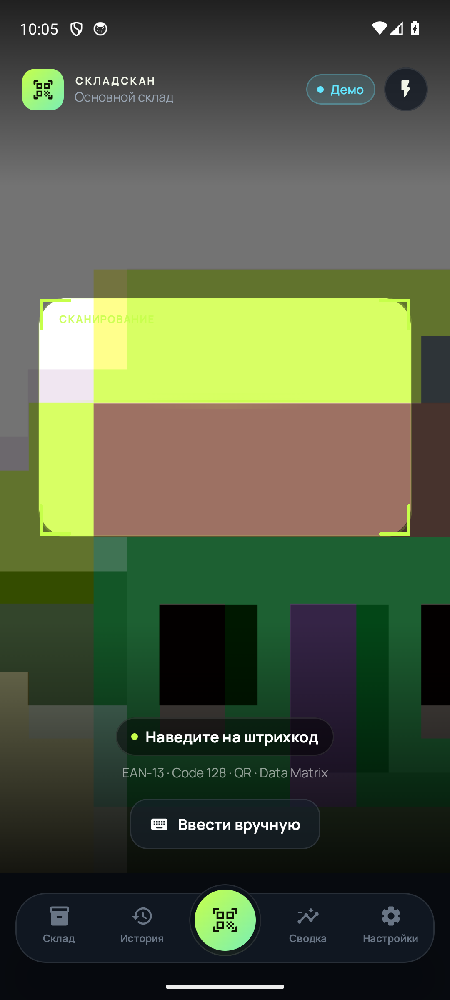
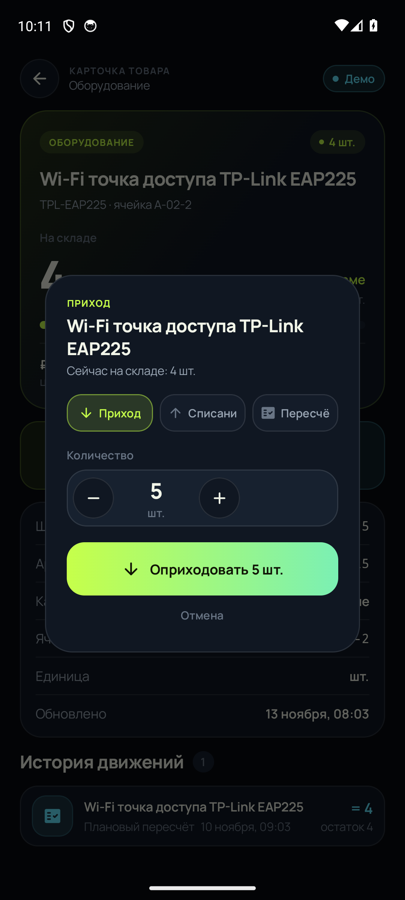
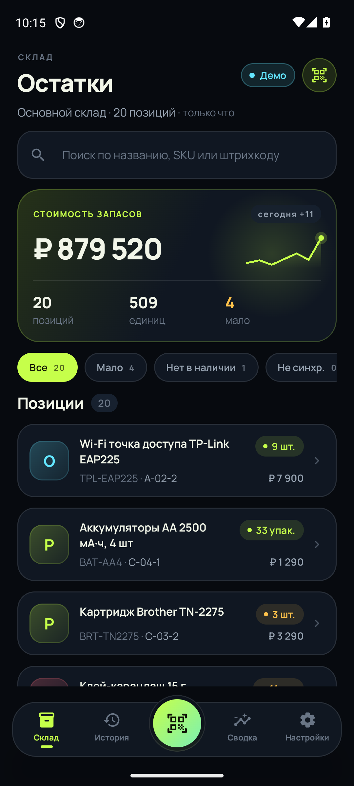
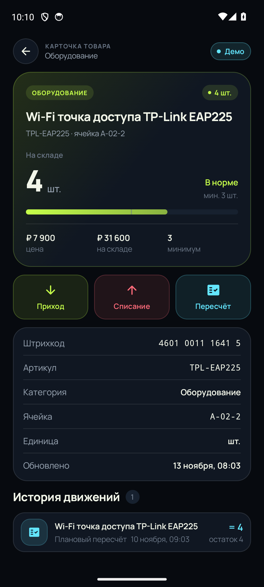
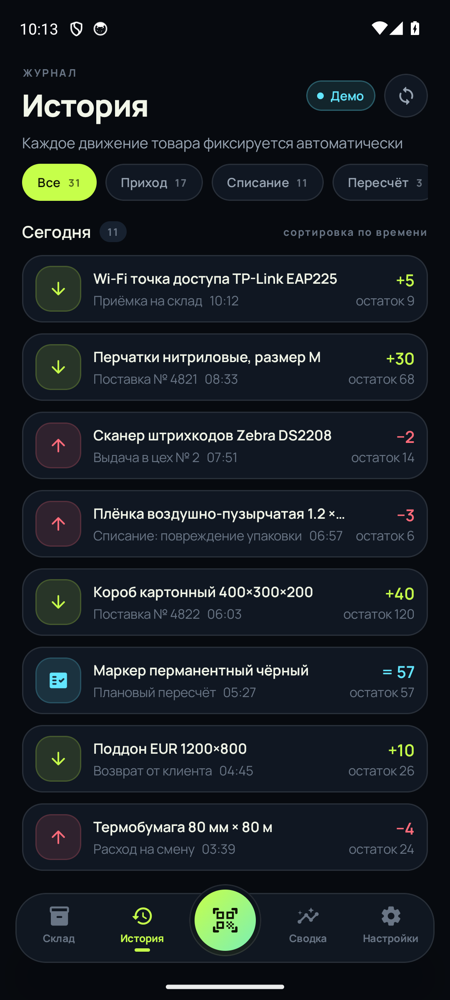
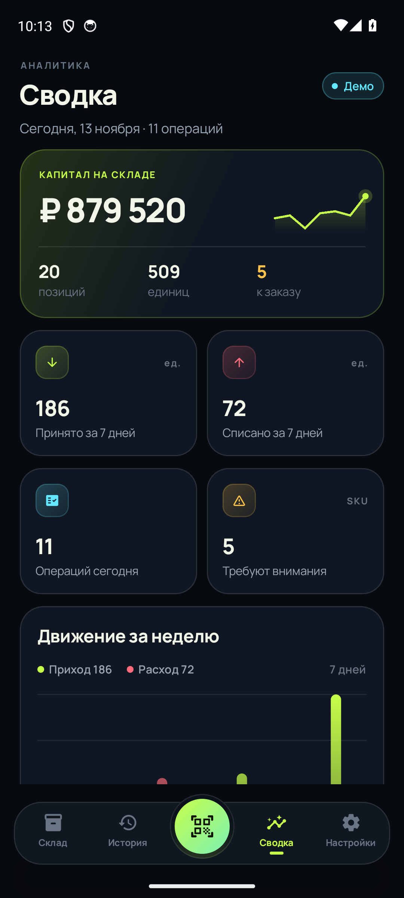
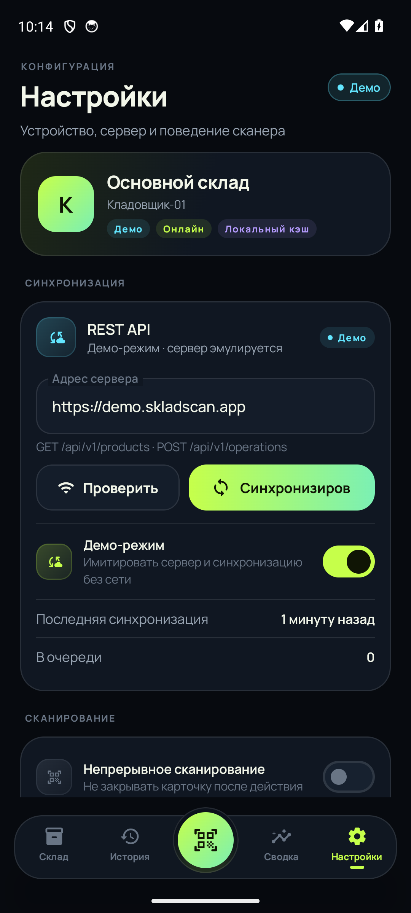

# СкладСкан — мобильный сканер штрихкодов для склада

Android-приложение для складского учёта: сканируешь штрихкод камерой телефона,
меняешь остаток в одно касание и работаешь даже без сети. Каждая операция
сохраняется локально и уходит на сервер, когда появляется связь.

> **Репозиторий:** https://github.com/yarikdurden/skladscan
> 

---

## Что умеет

| Возможность | Детали |
|---|---|
| Сканирование камерой | CameraX + ML Kit, 11 форматов: EAN-13/8, UPC-A/E, Code 128/39/93, ITF, QR, Data Matrix, PDF417 |
| Операции учёта | Приход, списание, пересчёт; валидация остатка, запрет отрицательных значений |
| Офлайн-первый | Room — источник правды, очередь операций с `clientOpId`, повторная отправка без дублей |
| Синхронизация | Retrofit + WorkManager + NetworkMonitor, фоновые ретраи, демо-режим без сервера |
| Экраны | Сканер, Остатки, Карточка товара, История, Сводка (аналитика), Настройки |
| Аналитика | Стоимость запасов, движение за 7 дней, дефицит по минимумам — всё локально |
| Демо-данные | 20 реальных складских позиций с валидными EAN-13 и 30 операций |

## Скриншоты

| Сканер | Результат | Остатки |
|---|---|---|
|  |  |  |

| Карточка товара | История | Сводка | Настройки |
|---|---|---|---|
|  |  |  |  |

## Стек

- Kotlin 2.0, Coroutines / Flow, MVVM, ручной DI
- Jetpack Compose, Material 3, кастомная дизайн-система (Manrope, тёмная «чернильная» тема)
- CameraX 1.4 + ML Kit Barcode Scanning
- Room 2.6 + KSP, DataStore
- Retrofit 2.11 / OkHttp / Gson
- WorkManager + NetworkMonitor
- min SDK 26 (Android 8), target SDK 34

## Сборка

Требуется JDK 17 и Android SDK 34.

```bash
# локальный путь к SDK
echo sdk.dir=C\:\\path\\to\\android-sdk > local.properties

./gradlew :app:assembleDebug      # APK: app/build/outputs/apk/debug/app-debug.apk
./gradlew :app:testDebugUnitTest  # unit-тесты бизнес-правил (11 кейсов)
```

> Важно: сборку и тесты запускайте из пути **без кириллицы** — иначе
> тестовый раннер не находит классы (`ClassNotFoundException`).

Для установки на устройство:

```bash
adb install -r app/build/outputs/apk/debug/app-debug.apk
```

## Архитектура

```
UI (Compose, MVVM)
   │ события
Домен (Repository, StockMath) ── валидация и правила учёта
   │ Flow
Room (источник правды)  +  Sync (Retrofit, WorkManager, очередь)
   │ batch / retry
REST API (1С / ERP / демо-режим)
```

- `clientOpId` делает отправку идемпотентной.
- UI никогда не ждёт сервер: показ остатков и проведение операций работают офлайн.
- Демо-режим эмулирует REST на устройстве — приложение можно показать без бэкенда.

## Структура проекта

```
app/src/main/java/com/skladscan/warehouse/
  data/        Room (entities, dao, db), Retrofit API, репозитории, DataStore
  domain/      модели и StockMath (правила учёта)
  sync/        SyncManager, SyncWorker
  ui/          scanner, stock, product, history, analytics, settings, components, theme
app/src/test/  StockMathTest — 11 unit-тестов правил
presentation/  HTML-презентация (index.html) + скриншоты + макеты (mockups.html)
tools/         make_qr.py / make_qr.bat — генератор QR для финального слайда
docs/          материалы
```

## Презентация

`presentation/index.html` — 14 слайдов, открывается в браузере, листается стрелками.
Печать в PDF: `Ctrl+P` → «Сохранить как PDF» (каждый слайд — отдельная страница).

Порядок слайдов: титул → проблема → решение → скриншоты (2 слайда) → возможности →
кому подходит → архитектура → альтернативы → сравнительная таблица →
где мы сильнее / где сильнее они → технологии → итог со ссылкой на GitHub.

## Ограничения

Нет готовой интеграции с 1С/ERP, нет управления ТСД/RFID/весами/принтерами этикеток,
нет партий и сроков годности, ролей и аудита, централизованного развёртывания, SLA.
Проект закрывает «последнюю милю» — быструю и честную операцию у полки, а не заменяет ERP.

## Лицензия

Укажите лицензию при публикации (например, MIT) — файл `LICENSE` в репозитории.
